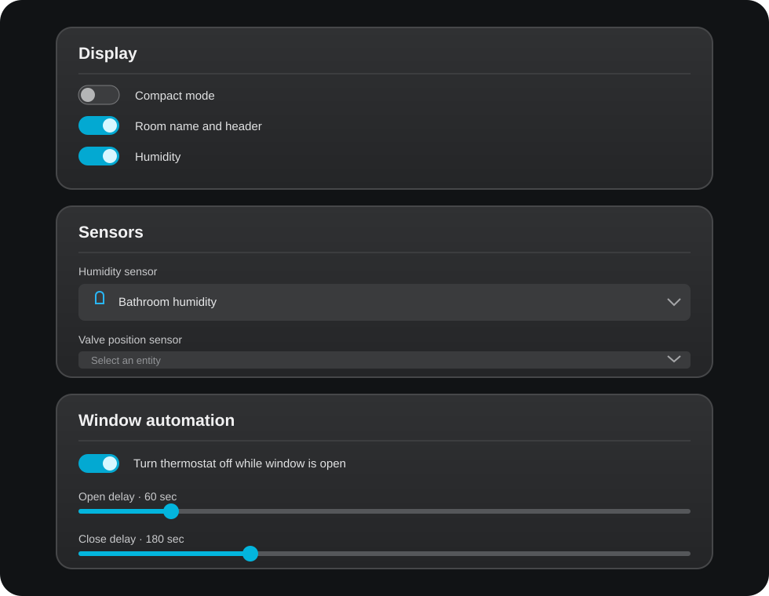

# Modern Thermostat Card

[](https://github.com/Letasil/modern-thermostat/releases)

A standalone Home Assistant Lovelace thermostat card. The trend chart, setpoint history, hover details, and nine language files are included; `mini-graph-card` is not required.

## Features

- Standard display view with temperature, operating status, humidity and any available optional sensor values
- HVAC and setpoint controls in standard and compact modes; the trend button appears when its sensor is available
- Compact mode shows room name, status, current temperature, humidity when available, and its two controls
- Fixed-size glass pills for status and humidity; sensor visibility follows available values
- Centers the temperature between the header and controls and aligns available humidity to its top edge in standard and compact mode
- Available valve position, Pi heat demand, and battery percentage are shown automatically
- Built-in temperature trend toggled by a button when a configured trend sensor has a usable value; it joins the thermostat in one continuous card
- Trend line with threshold colors, fading fill, extrema, times, setpoint history, and localized hover
- Optional window-contact automation with independent open and close delays; disabled by default
- Off controls are limited to modes/services advertised by the climate entity. If switching off drops the target to its minimum (commonly 5 °C), the card retains and restores the last confirmed setpoint, including when the integration keeps reporting an active HVAC mode.
- Expandable, localized editor sections with wide stacked window delay sliders
- German, English, Spanish, French, Dutch, Polish, Russian, Turkish, and Arabic translations
- Home Assistant light and dark theme support

## UI previews

These previews show the standard card with its built-in trend, the compact layout, and the localized configuration editor. Values and available sensors vary with your Home Assistant entities and theme.

<p align="center">
  
</p>
<table>
  <tr>
    <td width="50%" valign="top"></td>
    <td width="50%" valign="top"></td>
  </tr>
  <tr>
    <td align="center"><strong>Compact mode</strong></td>
    <td align="center"><strong>Configuration</strong></td>
  </tr>
</table>

<table>
  <tr>
    <td width="50%" valign="top"></td>
    <td width="50%" valign="top"></td>
  </tr>
  <tr>
    <td align="center"><strong>Compact mode</strong></td>
    <td align="center"><strong>Configuration</strong></td>
  </tr>
</table>

## Installation

### HACS custom repository

1. In HACS, add `https://github.com/Letasil/modern-thermostat` as a **Dashboard** custom repository.
2. Install the card.
3. Add `/local/community/modern-thermostat/modern-thermostat.js` as a JavaScript module resource if HACS has not added it automatically.
4. Reload the browser.

### Manual installation

1. Download the `modern-thermostat-v2.5.2.zip` release asset.
2. Copy `modern-thermostat.js` and the complete `translations/` folder into `config/www/community/modern-thermostat/`.
3. Add the resource as a JavaScript module:

```yaml
resources:
  - url: /local/community/modern-thermostat/modern-thermostat.js?v=2.5.2
    type: module
```

## Configuration

### Minimal

```yaml
type: custom:modern-thermostat
entity: climate.living_room
```

### Example with sensors and window automation

```yaml
type: custom:modern-thermostat
entity: climate.living_room
name: Living room
compact: false
humidity_entity: sensor.living_room_humidity
valve_position_entity: sensor.living_room_valve_position
heating_demand_entity: sensor.living_room_heat_demand
battery_entity: sensor.living_room_battery
window_entity: binary_sensor.living_room_window
window_auto_off: false
window_open_delay_seconds: 60
window_close_delay_seconds: 180
graph_entity: sensor.living_room_temperature
hours_to_show: 24
```

The graphical editor groups settings under **Thermostat**, **Sensors**, **Display**, and **Window automation**. The Boost option uses the same dimensions as the other mode buttons and highlights when active. Its live remaining-time display appears when the climate entity exposes boost timing data. In standard mode, sensor pills appear when values are available. The Trend button opens or closes the built-in chart when the selected sensor has a usable value. Compact mode keeps room/status, temperature, available humidity, and HVAC/setpoint controls; normal mode retains its HVAC and setpoint buttons. The window feature is disabled by default. When enabled, it turns the thermostat off after the open delay only if Home Assistant reports that the climate entity supports the off mode or TURN_OFF feature. Otherwise, it skips the off command without changing the target temperature. It restores the previous HVAC mode after the close delay. Delay sliders use seconds from 0 to 3600. Window automation runs in the browser while the dashboard is open; use a Home Assistant automation if it must run independently.

### Options

| Option | Type | Default | Description |
|---|---|---:|---|
| `entity` | string | required | Climate entity |
| `name` | string | climate friendly name | Optional display name |
| `icon` | string | automatic | Optional MDI icon |
| `compact` | boolean | `false` | Compact layout with HVAC and setpoint controls |
| `step` | number | `0.5` | Setpoint adjustment step |
| `decimals` | number | `1` | Temperature decimal places |
| `humidity_entity` | string | — | Optional humidity fallback sensor |
| `humidity_warning_level` | number | `70` | Humidity warning threshold |
| `valve_position_entity` | string | — | Optional valve position sensor; climate attributes are also detected |
| `heating_demand_entity` | string | — | Optional Pi heat-demand sensor; shown when a value is available |
| `battery_entity` | string | — | Optional battery percentage sensor (0–100%) |
| `battery_warning_level` | number | `25` | Low-battery threshold in percent |
| `graph_entity` | string | — | Temperature sensor; the built-in trend appears when its value is available |
| `hours_to_show` | number | `24` | Trend time range |
| `graph_line_width` | number | `2` | Temperature trend line width |
| `window_entity` | string | — | Optional binary window contact |
| `window_auto_off` | boolean | `false` | Turn off while the configured window contact is open, only when the climate entity reports off/turn_off support |
| `window_open_delay_seconds` | number | `60` | Delay before turning off, from 0 to 3600 seconds |
| `window_close_delay_seconds` | number | `180` | Delay before restoring the previous HVAC mode, from 0 to 3600 seconds |

## Compatibility

The card uses Home Assistant climate entities and their available attributes. Sensor displays depend on a usable numeric state or supported numeric attribute. Missing or unavailable values are hidden.

## Release

The repository includes a manually started GitHub Actions workflow. It creates a draft release and a HACS-ready ZIP containing the card and all translations. Review the draft before publishing it.

See [CHANGELOG.md](CHANGELOG.md) and [GITHUB_RELEASE_NOTES.md](GITHUB_RELEASE_NOTES.md) for the version history and release details.
